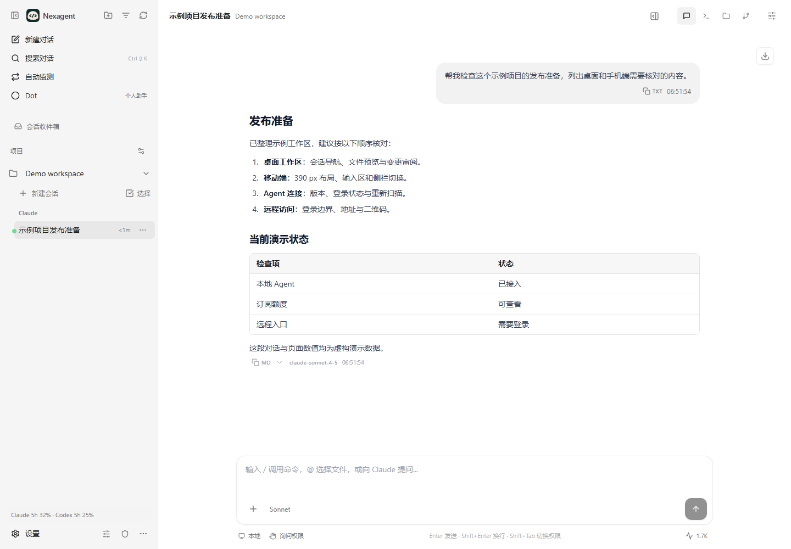
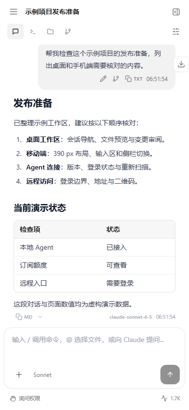

# Nexagent

一个后端统一管理 Claude Code、Codex、Cursor、OpenCode 和 WorkBuddy，
在桌面、手机和远程设备上继续工作。

[English](README.md) · [安装包](https://github.com/WGeorgezzzz/nexagent/releases)
· [更新日志](CHANGELOG.md) · [参与贡献](CONTRIBUTING.md)





## 功能

- 自动发现本机编码 Agent、检测版本和登录状态；重新扫描即可识别新安装程序。
- 多 Agent 共用项目工作区，支持对话、文件编辑、变更审阅和集成终端。
- 手机继续对话；队列、侧边对话和监测任务由服务器保存，关闭浏览器不结束任务。
- 多用户管理，成员的项目权限、凭据和偏好独立保存。
- Claude 订阅额度、个人中转 Key 用量、管理员上游账号池看板；显示点数变化和数据过期。
- 没有域名也能通过 Dev Tunnels、Tailscale 或 Cloudflare 临时隧道远程访问。

## 快速开始

### 安装包

从 [Releases](https://github.com/WGeorgezzzz/nexagent/releases) 获取安装包，
并对照 `SHA256SUMS` 校验。本轮 v1.0.0 保持草稿，维护者核对前仅仓库维护者可见。

| 平台 | 文件 | 说明 |
| --- | --- | --- |
| Windows x64 | NSIS `.exe` | 内置 Node.js 和后端；未签名 |
| macOS Apple silicon | `.dmg` | 未签名、未公证 |
| Linux x64 | `.tar.gz` | 解压后运行 `nexagent`，需要图形桌面 |

macOS 将应用拖入 Applications。确认来源与校验和后，首次被拦截时在
**系统设置 → 隐私与安全性 → 仍要打开** 中授权；受管设备可能需要管理员批准。
不要全局关闭 Gatekeeper。Windows 同样需要核对来源后再处理未签名提示。

首次启动会创建受操作系统身份保护的本机管理员，扫描 Agent，
并引导设置远程管理员密码、动态验证码和远程访问。远程功能可稍后配置。
桌面端使用独立数据目录，不接管其他运行中的服务。详见 [桌面配置](docs/DESKTOP.md)。

### npm

建议使用 Node.js 22.21+ 或 24.5+，并安装 Git；原生模块可能需要系统编译工具。
源码中的包名为 `nexagent`，**v1.0.0 尚未发布 npm**。正式发布后可执行：

```bash
npm install -g nexagent@1.0.0
nexagent start --port 3001
```

发布前可安装维护者提供的归档：

```bash
npm install ./nexagent-1.0.0.tgz
npx --no-install nexagent start --port 3001
```

打开 `http://localhost:3001` 创建首个管理员。Agent 本身需要安装并登录，
自动发现不会代替安装、购买订阅或授权。

### 源码

```bash
git clone https://github.com/WGeorgezzzz/nexagent.git
cd nexagent
npm ci
npm run build
node dist-server/server/modules/cli/cli.js start --port 3001
```

开发使用 `npm run dev`。回归检查为 `npm test`、`npm run test:client`、
`npm run typecheck` 和 `npm run lint`。

## 远程访问

管理员打开 **设置 → 远程访问**：

| 方式 | 访问范围 | 地址 |
| --- | --- | --- |
| Microsoft Dev Tunnels | GitHub 设备码授权，默认私有 | 持久隧道 ID |
| Tailscale Serve | 自己的 tailnet 设备 | `*.ts.net` |
| Tailscale Funnel | 支持并启用时公网可达 | `*.ts.net` |
| Cloudflare 临时隧道 | 无需隧道账号，公网可达 | 临时 `*.trycloudflare.com` |
| 自定义域名 | 自行配置隧道与 Cloudflare Access | 自己的域名 |

主机与服务须保持运行。经隧道访问一律需要 Nexagent 登录，不能借本机转发免登录。
管理员使用远程密码和 TOTP，成员使用自己的密码。二维码只包含地址，不包含凭据。
各隧道服务和 Agent 的账号、可用性与使用条款独立适用。

## 额度与安全

配置环境变量 `NEXAGENT_RELAY_BASE_URL=https://relay.example.com`，
或在 **设置 → 用量 → 中转地址** 保存。不配置时显示 **未配置中转**。
需要 sub2api 兼容的管理和用量接口；仅兼容模型生成接口并不足够。
凭据存放在仓库外，并绑定目标地址。详见 [额度配置](docs/QUOTA.md)。

成员不能查看上游账号池，也不能修改中转地址或隧道。Claude 凭据只读、不主动刷新。
看板负责观察，额度限制仍由中转调度器执行。Nexagent 没有点数重置操作，
不能据看板证明其他客户端绝不会消耗点数。

编码 Agent 和终端具备操作主机文件及执行命令的能力。仅向可信用户开放，
限制项目范围，保留 loopback 源站，并在暴露服务前配置登录边界。
自定义域名说明见 [访问安全](docs/PRIVATE-ACCESS.md)。不要在公开 issue 中提交凭据。

## 上游与许可

Nexagent 是 [CloudCLI / Claude Code UI](https://github.com/siteboon/claudecodeui)
的独立维护分叉，基于上游 1.37.5。与 Anthropic、OpenAI、Cursor、Microsoft
及上游维护者不存在官方产品关系，商标归各自权利人所有。

遵循 **AGPL-3.0-or-later**，保留 [LICENSE](LICENSE) 中的既有附加条款
和 [NOTICE](NOTICE) 中的上游署名。分发修改版本或提供网络服务时，
须履行对应源码提供义务。
